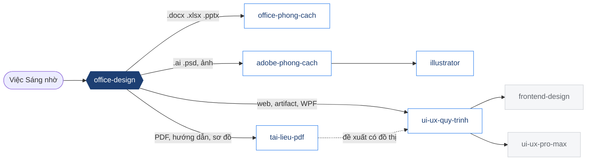

<picture>
  <source media="(prefers-color-scheme: dark)" srcset="assets/banner-dark.svg">
  
</picture>

<p align="center">
  
  
  
  
  
  
</p>

Bộ skill cho **Claude Code** gom lại cách Sáng làm tài liệu và thiết kế: khuôn Word/Excel/PowerPoint đã duyệt, PDF dựng từ HTML,
Adobe Illustrator và Photoshop, quy trình thiết kế giao diện UI/UX. Mỗi luật trong đây đến từ một lần làm thật — một lần Sáng
duyệt hoặc một lần Sáng chê — và trỏ về ghi chú gốc.

[Cài đặt](#cài-đặt) | [Chọn skill](#chọn-skill-nào) | [Cập nhật](#cập-nhật-từ-máy) | [Cấu trúc](#cấu-trúc) | [Bên thứ ba](#bên-thứ-ba) | [Nhật ký](CHANGELOG.md)

---

## 1. Office

| Skill | Dùng khi |
|---|---|
| [office-design](skills/office-design/SKILL.md) | **Cửa vào** — chưa rõ việc thuộc skill nào; luật chung cho mọi tài liệu |
| [office-phong-cach](skills/office-phong-cach/SKILL.md) | Word (form KHBD lề 2-2-3-2, báo cáo có mục lục + chú thích `SEQ`), Excel (kiểm công thức bằng Excel thật, file mẫu báo cáo), PowerPoint, script COM tiếng Việt |
| [tai-lieu-pdf](skills/tai-lieu-pdf/SKILL.md) | PDF từ HTML: hướng dẫn thao tác, nguyên lý máy, hướng dẫn có ảnh khoanh vùng, bài làm để chép, ôn thi có MathJax, đề xuất có đồ thị, sơ đồ draw.io |

Skill `docx`, `xlsx`, `pptx`, `pdf` của Anthropic có sẵn trong Claude và chạy cùng các skill trên; repo không chép chúng (giấy phép không cho).

## 2. Adobe

| Skill | Dùng khi |
|---|---|
| [adobe-phong-cach](skills/adobe-phong-cach/SKILL.md) | Chọn đường MCP hay JSX, Photoshop recipe, font tiếng Việt, luật soát ảnh |
| [illustrator](skills/illustrator/SKILL.md) | Lái Illustrator: MCP npx 66 tool + JSX qua COM, bốn bẫy đã trả giá (màu chữ, Arial Black, Pathfinder, khung chữ rỗng) |

Cấu hình MCP Illustrator, Photoshop: [mcp/](mcp/README.md).

## 3. UI/UX

| Skill | Dùng khi |
|---|---|
| [ui-ux-quy-trinh](skills/ui-ux-quy-trinh/SKILL.md) | Web, artifact, dashboard, app WPF: `frontend-design` trước dòng code đầu → bảng token → soát 5 kiểu "AI mặc định" → soát UX bằng `ui-ux-pro-max` |
| [frontend-design](vendor/frontend-design/skills/frontend-design/SKILL.md) | Bản lưu skill Anthropic (Apache-2.0) — cài bằng plugin |
| [ui-ux-pro-max](vendor/ui-ux-pro-max-skill/skills/ui-ux-pro-max/SKILL.md) | Tra 79 style, 192 bảng màu, 119 luật UX, 22 stack — kèm `banner-design`, `brand`, `design`, `design-system`, `slides`, `ui-styling` |

> [!IMPORTANT]
> Giao diện nào cũng qua `frontend-design` trước dòng code đầu, và soát tương phản, chỉ-màu, khoảng cách, trạng thái khoá bằng `ui-ux-pro-max` trước khi giao.

## Chọn skill nào



## Cài đặt

```powershell
git clone https://github.com/SangTDH-HT/Office_Design_Toolkit.git C:\Office_Design_Toolkit
cd C:\Office_Design_Toolkit
.\scripts\install.ps1 -WhatIf          # xem trước
.\scripts\install.ps1                  # cài skill chưa có vào ~/.claude/skills
.\scripts\install.ps1 -Force -WithUupmExtras   # ghi đè (có sao lưu) + 6 skill anh em của ui-ux-pro-max
```

Rồi trong Claude Code:

```text
/plugin install frontend-design@claude-plugins-official
/plugin marketplace add hugohe3/ppt-master
/plugin install ppt-master@ppt-master
```

`install.ps1` tự đổi `${CLAUDE_PLUGIN_ROOT}` trong `ui-ux-pro-max/SKILL.md` sang đường dẫn thật (giống `uipro init --ai claude --global`).
Bản cũ bị ghi đè nằm ở `~/.claude/skills-backup/<ngày-giờ>/`.

## Cập nhật từ máy

Skill vẫn chạy ở `~/.claude/skills`; repo là bản gom để lưu và cài lại. Sau khi sửa ghi nhớ trên máy:

```powershell
python scripts\sync.py --dry-run                        # xem sẽ chép gì
python scripts\sync.py --commit "Cập nhật phong cách"   # chép + soát + commit + push
```

`sync.py` chép các ghi chú theo [scripts/sources.tsv](scripts/sources.tsv), kéo bản mới của `ui-ux-pro-max-skill` và `frontend-design` về `vendor/`;
không đụng `SKILL.md` và các ghi chú đã lược tay. Ghi chú dính tên dự án bị bỏ qua kèm lời nhắc lược tay.
`check_repo.py` chặn commit khi frontmatter sai, liên kết hỏng, lọt token/mật khẩu, lọt tài liệu Anthropic có bản quyền hoặc lọt từ cấm
(danh sách từ cấm để ở `scripts/tu-cam.local.txt`, chỉ nằm trên máy).

## Cấu trúc

<details>
<summary>Cây thư mục</summary>

```text
Office_Design_Toolkit/
├─ assets/                  banner-light.svg, banner-dark.svg
├─ skills/
│  ├─ office-design/        cửa vào, luật chung
│  ├─ office-phong-cach/    SKILL.md + references/ (Word, Excel, script tiếng Việt)
│  ├─ tai-lieu-pdf/         SKILL.md + references/ (HTML→PDF, hướng dẫn, ôn thi, đặt tên file, draw.io)
│  ├─ adobe-phong-cach/     SKILL.md + references/ (MCP Python, Photoshop)
│  ├─ illustrator/          SKILL.md + mcp/ (66 tool, ranh giới MCP/JSX)
│  └─ ui-ux-quy-trinh/      SKILL.md + references/ (frontend-design, soát UX, WPF, chụp thử)
├─ vendor/
│  ├─ frontend-design/      Anthropic, Apache-2.0
│  └─ ui-ux-pro-max-skill/  nextlevelbuilder, MIT, v2.15.0 (7 skill)
├─ mcp/                     cấu hình mẫu Illustrator, Photoshop
├─ scripts/                 install.ps1, sync.py, sources.tsv, check_repo.py, banner_dark.py
├─ docs/HUONG-DAN.md        câu nhờ mẫu → skill nào chạy
├─ AGENTS.md, CLAUDE.md     hướng dẫn cho agent mở repo này
└─ CHANGELOG.md, THIRD_PARTY_NOTICES.md
```
</details>

## Bên thứ ba

| Thành phần | Nguồn | Giấy phép | Trong repo |
|---|---|---|---|
| frontend-design | anthropics/claude-plugins-official | Apache-2.0 | bản lưu ở `vendor/` |
| ui-ux-pro-max + 6 skill | nextlevelbuilder/ui-ux-pro-max-skill | MIT (font trong `ui-styling` theo OFL, skill theo Apache-2.0 kèm file) | bản lưu ở `vendor/` |
| illustrator-mcp-server | ie3jp | MIT | không chép, `npx` tự tải |
| ppt-master | hugohe3/ppt-master | MIT | không chép (107 MB), cài bằng plugin |
| docx, xlsx, pptx, pdf | Anthropic | độc quyền, cấm sao chép | **không chép** |

Chi tiết: [THIRD_PARTY_NOTICES.md](THIRD_PARTY_NOTICES.md).

## Quy ước

- Repo **riêng tư**. Không có token, mật khẩu, cấu hình máy thật; MCP chỉ có cấu hình mẫu.
- Không đưa tên dự án riêng vào repo — ghi chú dính tên dự án phải lược tay trước.
- Sửa luật thì sửa ở ghi nhớ gốc trên máy rồi chạy `sync.py`, để hai nơi không lệch nhau.
